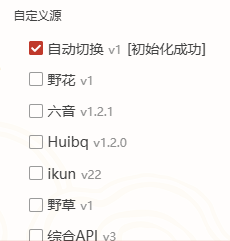

**语言 / Language:** [中文](README.md) | English

[aiv123.com](https://aiv123.com/) · AI tools directory, 600+ tools in one place

## 🚀 Recommended: [ofox.ai](https://ofox.io/x/aiv123)

> **In short**: One account for the latest GPT / Claude / Gemini and **100+** top models. First top-up gets an extra **$3** credit.

Text, image, video, and embeddings in one place. Caching supported — repeat calls stay cheaper and faster.

[👉 Sign up](https://ofox.io/x/aiv123) · Global dedicated lines · Enterprise SLA · No conversation retention

| ⚡️ Faster & Leaner | 🧠 Models & Modalities | 🛡️ Privacy |
|:---:|:---:|:---:|
| Global lines, enterprise SLA, plus caching | 100+ models · text / image / video / embeddings | No conversation retention |

## ☕ Buy Me a Coke

Open source takes effort — sponsorship is welcome:  
👉 [爱发电 / Afdian](https://ifdian.net/a/shellsec)

---

After install, Auto Switch is on by default, and the built-in sources are ready to use out of the box.

## Download

Local build outputs in `build/`, version **2.12.6**. This repository (`shellsec/lx-music-desktop-auto-source`) does not publish them on its Release.

- Windows installer: `lx-music-desktop-v2.12.6-x64-Setup.exe`
- Windows portable (7z): `lx-music-desktop-v2.12.6-win_x64-green.7z`
- macOS (Apple silicon, arm64): `lx-music-desktop-2.12.6-arm64.dmg`
- macOS (Intel, x64): `lx-music-desktop-2.12.6-x64.dmg`

[GitHub Releases](https://github.com/lyswhut/lx-music-desktop/releases) point to upstream `lyswhut/lx-music-desktop`.

### Accelerated download

This applies to the original URL of a Release asset: prefix that URL with `https://gh-proxy.com/`. Open the Releases page, copy an asset's original address, then add the prefix. An original address looks like `https://github.com/lyswhut/lx-music-desktop/releases/download/<tag>/<filename>`; the accelerated URL is `https://gh-proxy.com/` followed by that original address.
