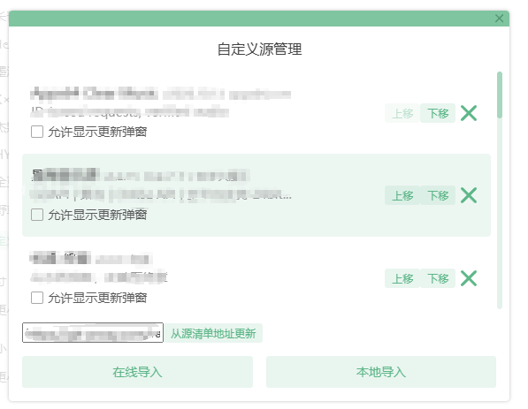

# 洛雪增强版

基于 [lyswhut/lx-music-desktop](https://github.com/lyswhut/lx-music-desktop) 二次开发，保留原作者版权声明及 Apache-2.0 许可证，修改说明见 NOTICE。

## 下载 v2.12.6

[查看发布页](https://github.com/shellsec/lx-music-desktop-auto-source/releases/tag/v2.12.6)

| 版本 | GitHub 下载 | 加速下载 |
| --- | --- | --- |
| Windows x64 安装版 | [直接下载](https://github.com/shellsec/lx-music-desktop-auto-source/releases/download/v2.12.6/lx-music-desktop-v2.12.6-x64-Setup.exe) | [加速下载](https://gh-proxy.com/https://github.com/shellsec/lx-music-desktop-auto-source/releases/download/v2.12.6/lx-music-desktop-v2.12.6-x64-Setup.exe) |
| Windows x64 7z 解压版 | [直接下载](https://github.com/shellsec/lx-music-desktop-auto-source/releases/download/v2.12.6/lx-music-desktop-v2.12.6-win_x64-green.7z) | [加速下载](https://gh-proxy.com/https://github.com/shellsec/lx-music-desktop-auto-source/releases/download/v2.12.6/lx-music-desktop-v2.12.6-win_x64-green.7z) |
| Windows x64 单文件免安装版 | [直接下载](https://github.com/shellsec/lx-music-desktop-auto-source/releases/download/v2.12.6/lx-music-desktop-v2.12.6-x64-portable.exe) | [加速下载](https://gh-proxy.com/https://github.com/shellsec/lx-music-desktop-auto-source/releases/download/v2.12.6/lx-music-desktop-v2.12.6-x64-portable.exe) |

安装版运行 Setup.exe 安装；7z 版解压后运行 `lx-music-desktop.exe`；单文件免安装版直接运行 portable.exe。以上均为 Windows x64。

## 导入自定义源

本软件不提供任何音源。首次启动，自定义源列表为空。请在设置中导入自定义源，选择用户自己的本地脚本，或填写用户自己的脚本地址。未导入时提示「请在设置中导入自定义源」。

1. 打开设置中的「自定义源」管理窗口。
2. 点击「本地导入」选择自己的源脚本，或点击「在线导入」填写自己的脚本地址。
3. 导入后可使用「上移」「下移」调整源的重试顺序，点击右侧删除按钮移除不再使用的源。

上图展示用户自行导入后的界面，源信息与地址已打码。本软件不预置图中的任何源，首次启动列表为空。

## 多源自动切换

图中为启用后的状态，首次启动时默认关闭。导入自己的源后，在设置的「自定义源」区域勾选「多源自动切换」即可启用；选择单个源即可退出多源自动切换。

播放失败后仅按用户列表顺序尝试其余已导入的源，每轮中每个源最多尝试一次。可在自定义源列表中调整顺序。全部失败后，若保存了订阅地址，会自动检查一次订阅；仅清单或脚本有变化时，按用户顺序再重试一轮，然后停止。

## 订阅更新

清单地址默认为空。在设置的自定义源窗口填写用户自己的清单地址，点击「保存订阅地址」即可持久保存，也可点击「从源清单地址更新」手动更新。关闭窗口时也会保存输入的地址。示例地址仅为 `https://example.com/sources.json`。

支持 JSON 数组或 `{ "sources": [...] }`，每项包含 `id`、`name`、`url`，脚本地址须使用 HTTPS。同一首歌对同一订阅地址最多自动检查一次，连续切歌时自动检查间隔至少 60 秒；手动更新不受该冷却限制。地址为空时不会请求远程。清单与脚本内容都未变化时不重新加载或重试。

更新会保留本地导入的源和已有顺序，清理清单中已删除的订阅条目并追加新条目；下载或格式校验失败时保留原列表。

## 开发与验证

使用 Node.js 22 或以上版本，运行 `npm ci`、`npm run lint`、`npm run build`。运行 `npm run test:sources` 验证空列表、导入、顺序重试和订阅解析。运行 `npm run pack:dir` 生成应用目录，发布构建会检查分发文件不包含源脚本资源。

## 免责声明

本软件不提供任何音源，用户导入的内容由用户自行负责，请遵守当地法律与版权。
